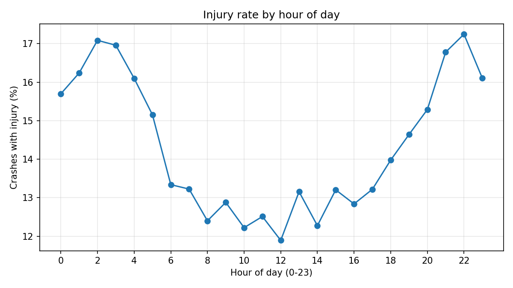
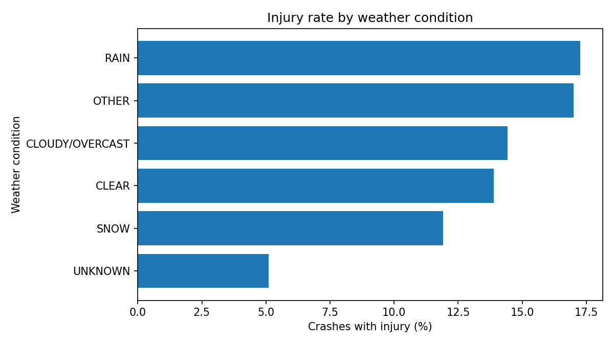
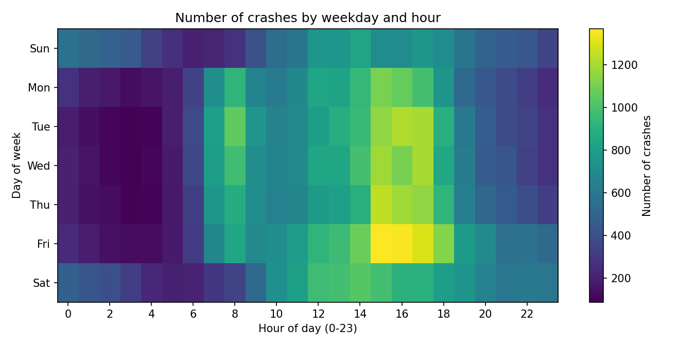

# Chicago Traffic Crashes: data pipeline and injury model
Source: Chicago Data Portal (Chicago Police E-Crash), Kaggle mirror anoopjohny/traffic-crashes-crashes. Access date: 19 Nov 2026. Licence: TODO (check).
AI tools used: TODO (list them here).

## Run
pip install -r requirements.txt, then run the scripts in order: sample, pipeline, analysis, train, error analysis, predict. Tests: python -m pytest.

## Data quality (before/after)
```
{
  "rows_raw": 100000,
  "columns_raw": 48,
  "missing_pct_before": 21.04,
  "duplicate_ids_in_raw": 0,
  "validation_pass_rate": 0.9883,
  "threshold": 0.9,
  "rows_clean": 99797,
  "columns_clean": 47,
  "rows_removed_total": 203,
  "columns_dropped": [
    "LANE_CNT",
    "WORK_ZONE_TYPE"
  ],
  "missing_pct_after": 0.06,
  "injury_rate_pct": 13.68,
  "quality_gate": "PASSED"
}
```

## Figures

*Share of crashes that involve an injury, for each hour of the day.*


*Injury rate for the eight most common weather conditions.*


*Crash counts by weekday and hour; the busiest times are weekday rush hours.*

## SQL
Query 1 (GROUP BY): sql/injury_by_lighting.sql. Query 2 (JOIN): sql/injury_by_weekday_join.sql.
```
    LIGHTING_CONDITION  crashes  injury_rate_pct
DARKNESS, LIGHTED ROAD    21928             17.2
                  DAWN     1676             15.6
                  DUSK     2875             13.6
              DAYLIGHT    64094             13.2
              DARKNESS     4712             12.5
               UNKNOWN     4512              3.9
```
TODO: explain in your own words what this result shows.

## Model comparison
```
                         model  cv_precision  cv_recall  cv_f1  cv_roc_auc  cv_pr_auc
      Baseline (most frequent)         0.000      0.000  0.000       0.500      0.137
           Logistic Regression         0.305      0.734  0.431       0.820      0.514
                 Random Forest         0.410      0.579  0.480       0.824      0.511
        Hist Gradient Boosting         0.332      0.715  0.453       0.830      0.527
Hist Gradient Boosting (tuned)         0.325      0.723  0.448       0.828      0.525
```
Test metrics: {"chosen_model": "Hist Gradient Boosting", "precision": 0.3308, "recall": 0.7228, "f1": 0.4539, "roc_auc": 0.8291, "pr_auc": 0.5296, "no_skill_pr_auc": 0.1368}